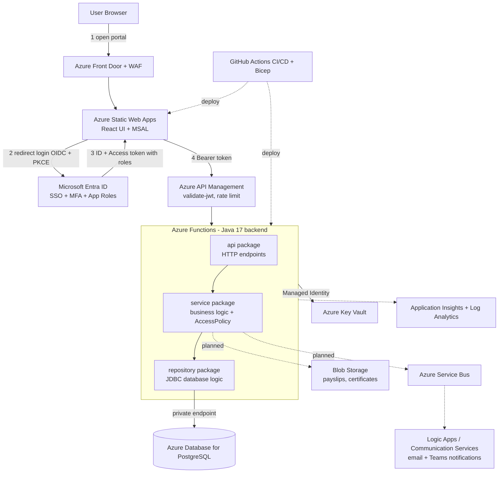

# Employee Management Portal – Architecture

## Diagram (Mermaid: renders as an image in VS Code Markdown Preview, GitHub, Azure DevOps wiki)



Solid lines are built in this repo; dotted lines are planned / infrastructure.

## Login flow (A to Z)
1. User opens the portal (Front Door → Static Web App serving the React UI).
2. MSAL redirects to **Entra ID** (SSO, MFA, Conditional Access).
3. Entra returns an access token for `api://<api-client-id>` containing the user's **App Roles** (`Employee`, `HR`, `Director`, `Admin`) and `oid`.
4. UI calls `GET /api/v1/me` with `Authorization: Bearer <token>`; the response (employee + roles) decides which screens to show.
5. Every API call is re-validated in the backend (`EntraTokenValidator`: signature via Entra JWKS, issuer, audience, expiry). Role checks live in `service/security/AccessPolicy`, so hiding UI menus is cosmetic only.
6. Services use repositories (JDBC) to read/write PostgreSQL. Salary views by HR/Director are written to `audit_log`.

## Code layout (api → service → repository only)
```
src/main/java/com/emp
├── api/         Azure Function endpoints only (MeApi, EmployeeApi, SalaryApi, HolidayApi, LeaveApi, TrainingApi)
├── service/     business logic + rules (interfaces + *Impl); service/security = token validation + AccessPolicy
├── repository/  database interfaces; repository/jdbc = PostgreSQL implementations (Db, Sql helper)
├── model/       Employee, Salary, Holiday, LeaveRequest, TrainingRequest, Decision, Role
└── common/      Endpoint (auth + JSON + errors), ServiceFactory (wiring), AuthContext, ApiException, Json
src/main/resources/db/schema.sql   PostgreSQL schema
```

## Who can do what
| Capability | Employee | HR | Director | Admin |
|---|---|---|---|---|
| Own profile, salary, joining date | yes | yes | yes | yes |
| Any employee profile / salary | no | yes | yes (read-only) | no |
| Create employees, set salary | no | yes | no | no |
| View public holidays | yes | yes | yes | yes |
| Add holidays | no | yes | no | yes |
| Apply / track own leave, request training | yes | yes | yes | yes |
| Approve / reject leave and training (never your own) | no | yes | yes | no |

## API (all under `/api/v1`, all need a Bearer token)
| Method | Route | Purpose |
|---|---|---|
| GET | `/me` | profile + roles |
| GET | `/me/salary` | my salary |
| GET | `/me/leaves` | track my leave |
| GET | `/me/trainings` | track my training requests |
| GET / POST | `/employees` | list (HR, Director) / create (HR) |
| GET | `/employees/{id}` | one employee (self, HR, Director) |
| GET / PUT | `/employees/{id}/salary` | view (HR, Director, audited) / set (HR) |
| GET / POST | `/holidays` | list / add (HR, Admin) |
| POST | `/leaves` | apply for leave |
| GET | `/leaves/pending` | pending leave (HR, Director) |
| POST | `/leaves/{id}/decision` | `{"approved": true}` (HR, Director) |
| POST | `/trainings` | request extra training |
| GET | `/trainings/pending` | pending training (HR, Director) |
| POST | `/trainings/{id}/decision` | `{"approved": true}` (HR, Director) |

## Setup checklist
1. **Entra ID**: register an API app and a SPA app and define the roles. Step-by-step in [ui/README.md](../ui/README.md#entra-id-setup-one-time). Note: the API app manifest needs `accessTokenAcceptedVersion: 2`, and `ENTRA_API_AUDIENCE` is the API app's client ID GUID (not the `api://` URI).
2. **PostgreSQL**: create the database and run `src/main/resources/db/schema.sql`. Create employee rows (email must match the user's Entra login) and `leave_balances` rows; the first login links the Entra `oid` automatically.
3. **App settings** (Function App, ideally Key Vault references): `DB_URL`, `DB_USER`, `DB_PASSWORD`, `ENTRA_TENANT_ID`, `ENTRA_API_AUDIENCE`. Copy `local.settings.sample.json` to `local.settings.json` for local runs (it also sets CORS for the UI dev server).
4. Backend: `mvn clean package` then `mvn azure-functions:run`.
5. UI: see [ui/README.md](../ui/README.md) (`npm install`, `npm run dev`).

## Not built yet (planned)
Bicep + GitHub Actions, notifications (Service Bus), payslip storage, admin audit-log endpoint, Flyway migrations, Key Vault / Managed Identity wiring for the DB password, production CORS on the Function App.
